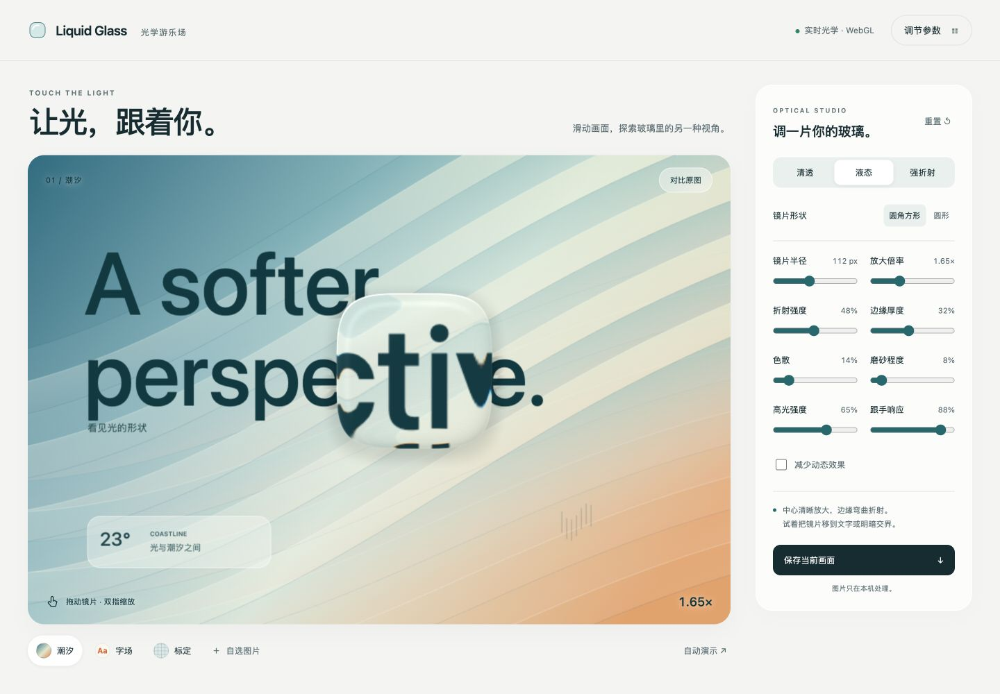

# Liquid Glass · 光学游乐场

苹果 Liquid Glass 风格的交互放大镜 H5：手指或鼠标滑到哪里，镜片就放大并折射哪里的画面。使用原生 WebGL 和 GSAP，支持离线运行。



## 运行

直接用浏览器打开 `liquid-glass.html`，无需安装依赖。也可在项目目录启动服务器：

```sh
python3 -m http.server 8772
```

然后打开 http://localhost:8772/ 。

`index.html`、`style.css` 和 `app.js` 是源码版；`liquid-glass.html` 为内嵌脚本与样式的单文件版。修改源码后运行 `python3 build.py` 更新单文件。

## 功能

- 鼠标跟随、手指拖动、双指缩放；方向键移动，+/− 调整镜片半径。
- 八个参数：半径、放大倍率、折射强度、边缘厚度、色散、磨砂程度、高光强度、跟手响应。
- 清透、液态、强折射三种预设；圆形与圆角方形镜片。
- 潮汐、文字、标定网格背景，以及本地图片载入。
- 原图对比、自动演示、PNG 导出、减少动态模式。
- 图片只在本机处理，无网络上传、分析脚本或 CDN 依赖。

## 光学与交互

Canvas2D 生成画面纹理，单次 WebGL 绘制完成中心放大、边缘折射、色散、反射高光和阴影。折射使用表面法线与 GLSL `refract`，空气/玻璃折射率比为 1/1.46。移动高光、按压反馈和沿运动方向的微小形变增强玻璃的质感。跟随使用按时间步长计算的指数阻尼。

参考 [Apple 官方 Liquid Glass 展示](https://www.apple.com.cn/newsroom/2025/06/apple-introduces-a-delightful-and-elegant-new-software-design/) 和 [WWDC25 官方说明](https://developer.apple.com/videos/play/wwdc2025/219/)。这是屏幕空间视觉近似，并非 Apple 原生渲染器的逐像素复刻。镜片作用于画面纹理或选择的图片，不会自动抓取任意网页 DOM。

## 性能和兼容

DPR 上限 2，总画布像素预算 360 万，纹理遵守 GPU 尺寸上限。本地图片限制 30 MB，解码后最长边缩至 2048 px。静止、后台和离开视口时停止绘制；支持 WebGL 静态降级和上下文恢复。`?preview=static` 可查看静态降级。

尊重系统 `prefers-reduced-motion`，也可手动开启减少动态效果。系统字体在 Apple 设备上使用 San Francisco / 苹方；不分发 Apple 字体。

## 第一版验证

- JavaScript 语法检查通过。
- 320 / 375 / 390 / 414 / 768 / 1440 屏宽无横向溢出。
- 默认与减少动态模式五点拖动落点误差小于 1 CSS 像素。
- 八个参数上下限、预设、背景、形状、键盘、面板切换、图片载入和非空 PNG 导出已检查。
- 桌面连续约 82 秒，渲染循环约 60 次/秒；静止后停止绘制。这不是手机 GPU 基准。
- 单文件无外部脚本和样式依赖，静态降级已检查。

详细记录见 `tests/validation.json`。测试图片为本地生成的 `tests/upload-fixture.png`，没有使用私人图片。尚未验证真机 iPhone Safari、多指触摸、GPU 上下文丢失注入、系统减少动态偏好模拟及 Lighthouse。

## Skills 与依赖

[motion-web](https://github.com/feitangyuan/motion-web) 用于布局、shader 和交互；[GSAP skills](https://github.com/greensock/gsap-skills) 用于参数补间与性能检查。[Remotion skills](https://github.com/remotion-dev/skills) 可用于后续演示视频，本版无需使用。

附带 GSAP 3.15.0，来源和包校验信息见 `vendor/source.json`，其许可与说明见 `vendor/README.md` 及库文件头部。
